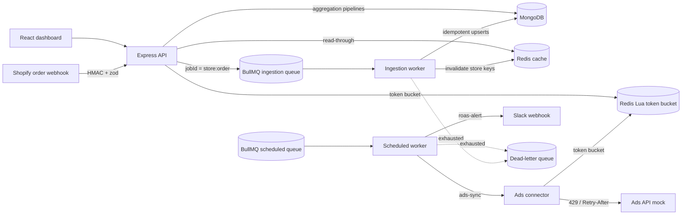

# Commerce Analytics Engine

Marketing analytics backend and dashboard for e-commerce stores. It ingests Shopify-style order webhooks through a Redis-backed job queue, pulls ad spend from a rate-limited ads API, and computes **ROAS** and **multi-touch revenue attribution** with MongoDB aggregation pipelines. A React dashboard shows the results, and a scheduled job posts a Slack alert when ROAS drops below a threshold.

**Stack:** Node.js 20, TypeScript, Express, MongoDB (Mongoose + native aggregation), Redis, BullMQ, zod, React + Vite + Recharts, Jest + Supertest, Docker Compose, GitHub Actions.

## What it does

| Area | Implementation |
|---|---|
| Webhook ingestion | HMAC-SHA256 verification of the raw body (constant-time compare), zod validation, `202 Accepted` and hand-off to a BullMQ queue instead of processing inline |
| Idempotency | Three layers: persisted-order check, deterministic BullMQ job id (`storeId:orderId`), and `$setOnInsert` upserts behind a unique `(storeId, orderId)` index |
| Background workers | BullMQ workers with exponential-backoff retries; jobs that exhaust their attempts are copied to a dead-letter queue with the error and payload |
| Rate limiting | Token bucket implemented as one Redis Lua script (refill, take and write-back are atomic), used as Express middleware with `429` + `Retry-After`, and on outbound ads API calls |
| Third-party API resilience | Ads connector batches campaign ids, honours `Retry-After` on `429`, retries `5xx` with capped exponential backoff and jitter, gives up after 5 retries, and validates responses |
| Aggregations | Daily ROAS per channel; first-touch, last-touch and linear attribution in one `$facet` pass; customer-journey length buckets |
| Caching | Redis read-through cache on metric endpoints (`X-Cache: HIT/MISS`); per-store invalidation with `SCAN` + `UNLINK` (never `KEYS`) after the worker writes |
| Scheduled jobs | `ads-sync` (every 30 min) upserts one spend row per campaign per day; `roas-alert` (daily) posts to a Slack incoming webhook when blended ROAS is below the threshold |
| Dashboard | Date and channel filters, KPI tiles, per-channel ROAS trend, attribution comparison table, loading / error / empty states with retry |

## Architecture



## Run locally

Requirements: Docker, Node.js 20+.

```bash
cp .env.example .env
docker compose up --build
docker compose exec api npm run seed     # 14 days of demo orders, touchpoints and ad spend
```

| Service | URL |
|---|---|
| Dashboard | http://localhost:5173 |
| API | http://localhost:4000/health |
| Mock ads API | http://localhost:4100/health |

Without Docker for the apps (MongoDB and Redis still need to be running):

```bash
npm install && npm --prefix apps/dashboard install
npm run dev:api & npm run dev:worker & npm run dev:mock-ads & npm run dev:dashboard
```

Set `MONGO_URL`, `REDIS_URL` and `MOCK_ADS_URL` in `.env` to `localhost` addresses in that case.

## API

### `POST /webhooks/shopify/orders`

Headers: `x-shopify-hmac-sha256` (base64 HMAC-SHA256 of the raw body with `SHOPIFY_WEBHOOK_SECRET`), optional `x-store-id`.

```json
{
  "id": 12345,
  "customer": { "id": 7, "touchpoints": [
    { "channel": "meta", "campaignId": "summer", "occurredAt": "2026-10-19T09:00:00Z" }
  ]},
  "total_price": "79.95",
  "currency": "USD",
  "created_at": "2026-10-19T10:00:00Z"
}
```

| Status | Meaning |
|---|---|
| `202` | Queued (`jobId` returned). A redelivery before processing returns `202` again but does not enqueue a second job |
| `200` | Duplicate: the order is already stored |
| `400` | Signed but invalid payload; `error.details` lists the failing fields |
| `401` | Missing or invalid signature |

### Metrics (rate-limited, cached)

| Endpoint | Returns |
|---|---|
| `GET /api/metrics/roas?storeId&from&to&channel` | One row per day and channel: revenue, spend, orders, ROAS (`null` when spend is 0) |
| `GET /api/metrics/attribution?storeId&from&to` | `{ channels: [{ channel, firstTouch, lastTouch, linear, touches, customers }], journeys: [...] }` |
| `GET /api/metrics/journeys?storeId&from&to` | Customers bucketed by number of touches, with average unique channels and journey duration |
| `GET /api/channels?storeId` | Channels seen in touchpoints |
| `POST /api/ad-spend` | Validated manual spend entry; invalidates the store's cache |

Ranges are ISO dates; `from` must precede `to` and a range is limited to 366 days.

## Data model and indexes

Every index leads with `storeId` because every query is tenant-scoped.

| Collection | Index | Serves |
|---|---|---|
| orders | `{storeId, orderId}` unique | Idempotent ingestion |
| orders | `{storeId, occurredAt, channel}` | ROAS `$match` on date range and channel |
| orders | `{storeId, customerId, occurredAt}` | The attribution `$lookup` (customer revenue inside the window) |
| touchpoints | `{storeId, customerId, occurredAt}` | Building ordered journeys |
| touchpoints | `{storeId, channel, occurredAt}` | Channel and date analysis |
| adspends | `{storeId, occurredAt, channel}` | ROAS spend grouping |
| adspends | `{storeId, campaignId, occurredAt}` unique (partial) | One row per campaign per day, so re-syncs overwrite |

## Aggregation pipelines

**Daily ROAS.** Orders and ad spend are each `$match`ed and `$group`ed by `{ $dateTrunc: day, channel }`, then joined in application code. A `$lookup` between them would multiply revenue by the number of spend rows on that day. Spend-only days are kept, so a channel that spent money but sold nothing shows a ROAS of 0, not a missing row.

**Attribution** (`attributionPipeline` in `apps/api/src/aggregations.ts`):

1. `$match` touchpoints in the window, then `$sort` by customer and time.
2. `$group` per customer, `$push`ing channels to get the ordered journey.
3. `$lookup` (pipeline form) sums that customer's order revenue within the same store and window.
4. `$set` derives revenue, touch count and the first and last channel.
5. `$facet` computes three models in parallel:
   - first touch: all revenue to the first channel
   - last touch: all revenue to the last channel
   - linear: `revenue / touchCount` credited to every touch, plus touch and distinct-customer counts
   - journey-length buckets
6. `$project` with `$map` / `$filter` merges the facets into one row per channel.

The pipeline is tested against a plain TypeScript reference implementation (`attribution.ts`) on the same fixture.

## Queues, retries and dead-letter queue

| Queue | Jobs | Retry policy |
|---|---|---|
| `commerce-ingestion` | Shopify orders | 5 attempts, exponential backoff from 1 s |
| `commerce-scheduled` | `ads-sync`, `roas-alert` (BullMQ job schedulers, idempotent across restarts) | 3 attempts, exponential backoff from 5 s |
| `commerce-dead-letter` | Copies of jobs that exhausted their attempts: payload, error and attempt count | — |

Workers drain in-flight jobs and close every Redis and MongoDB connection on `SIGINT`/`SIGTERM`.

## Tests

```bash
docker compose up -d mongo redis
TEST_MONGO_URL=mongodb://localhost:27017 REDIS_URL=redis://localhost:6379 npm run test:coverage
```

Without `TEST_MONGO_URL` the suites start an in-memory MongoDB (`mongodb-memory-server`, which downloads a binary on first run). Redis is always real.

| Suite | Covers |
|---|---|
| `unit/backoff` | Retry-After parsing and caps, exponential growth and jitter bounds |
| `unit/connector` | Batching, 429 + Retry-After, 5xx retry, no retry on 4xx, retry exhaustion, waiting on the limiter, response validation |
| `unit/validation` | HMAC accept and reject cases, payload coercion and rejection |
| `unit/attribution` | Reference attribution maths |
| `integration/limiter` | Lua bucket on real Redis: capacity, time-based refill, 50 concurrent takes on a 10-token bucket admit exactly 10, TTL, 429 middleware |
| `integration/cache` | Hit and miss, falsy values, `SCAN` invalidation across 650 keys without touching other stores |
| `integration/dlq` | Real BullMQ worker: retries to the limit then dead-letters; a job that recovers on retry is not dead-lettered |
| `integration/aggregation` | ROAS join and edge cases, tenant isolation, attribution matching the reference, exact per-channel credit, journey buckets |
| `integration/api` | Webhook 401/400/202/200 and single enqueue on redelivery; cache HIT/MISS; range validation; ad-spend validation and invalidation; per-client 429; JSON 404 |
| `integration/processors` | Idempotent order upserts under retry; ad-spend re-sync overwrites; Slack alert below threshold, quiet above it, throws on Slack failure |

CI runs type check, lint, build and the full suite with coverage against real `mongo:7` and `redis:7` service containers, and builds the dashboard.

## Configuration

All settings live in `.env.example`. The defaults are for local development: change `SHOPIFY_WEBHOOK_SECRET` before exposing the webhook, and set `TRUST_PROXY` to match your load balancer so rate limiting keys on the real client IP.

## Known limitations

- The ads integration targets a local mock API; there is no real Meta or Google Ads client or OAuth flow.
- Single-store scheduling: `ads-sync` and `roas-alert` run for `DEFAULT_STORE_ID`. Multi-store would need one scheduler per store or a fan-out job.
- No authentication on `/api` routes; the dashboard is an internal demo.
- Dead-lettered jobs are stored for inspection; there is no replay endpoint yet.
- Attribution is computed per request (cached). Very large stores would need pre-aggregated daily rollups.
